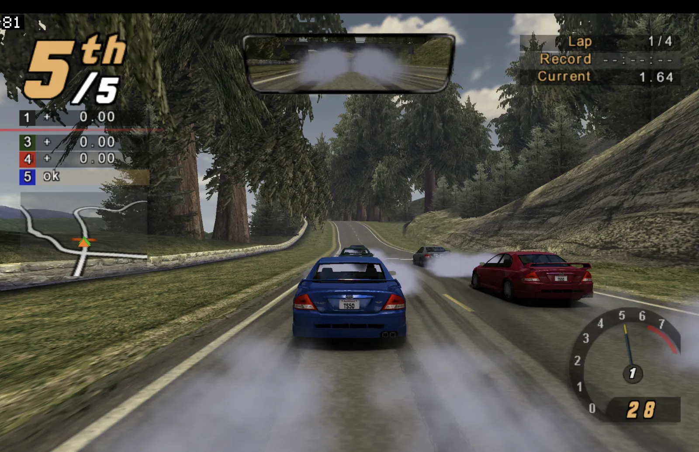
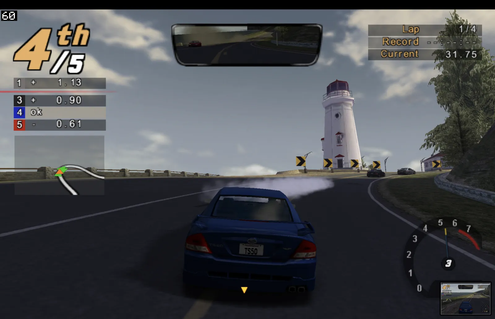
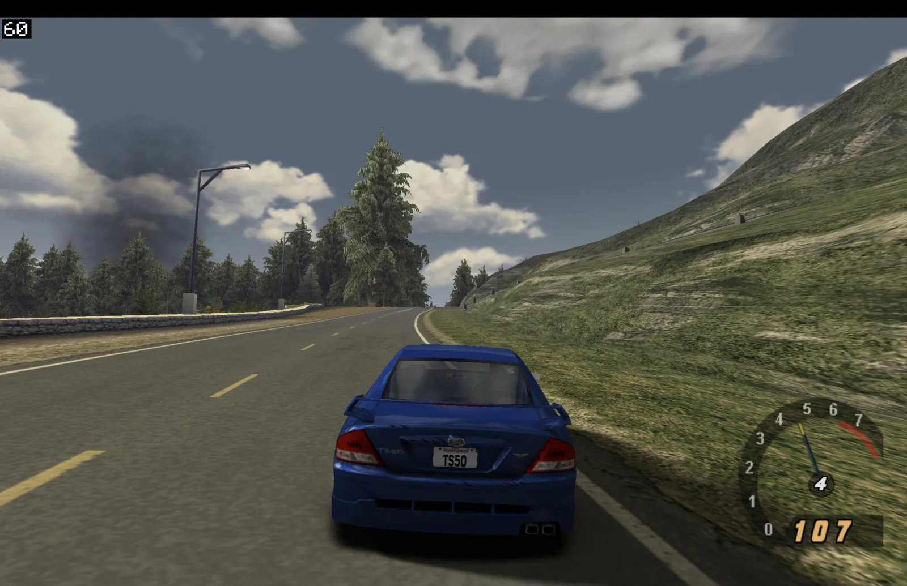
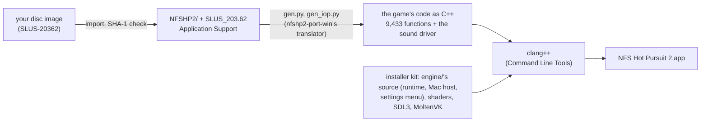
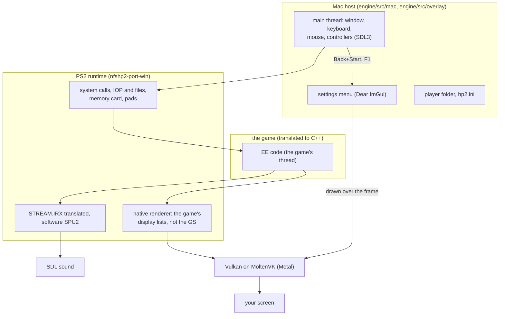

# NFS Hot Pursuit 2 for Mac

*Need for Speed: Hot Pursuit 2* (EA Black Box, 2002), the PlayStation 2 version, running natively on Apple Silicon Macs.

## What it is

The game's own program, translated from the PS2's MIPS code into C++ and compiled for your Mac. It is not an emulator: there is
no virtual PS2, the game runs as a normal Mac app with the disc's own cars, tracks, music and menus, which look and work as they
do on the PS2. On top of that, a settings menu over the game (as in the other ports in this series) gives what makes it play well
on a Mac: 60 fps or more, a 16:9 or 16:10 picture, a higher resolution, anti-aliasing, keys and controllers.

Almost everything here is other people's work, and this is their port as much as ours:

- [nfshp2-port-win](https://github.com/ZloiKILLER/nfshp2-port-win) by **ZloiKILLER** is the static recompilation of the PS2
  game for Windows: the recompiler, the runtime that stands in for the PlayStation 2, the renderer that draws the game's own
  display lists on Vulkan, the sound.
- [nfshp2-web](https://github.com/vitorinii/nfshp2-web) by **Vitorini** showed how to run it outside Windows.

This project adds the macOS host (window, input, sound, Vulkan on Metal), switches the menus back to the PS2's, adds the settings
menu and the installer, and keeps the same style as the other ports in this series
([NFS Underground 2](https://github.com/sanyokkua/nfsu2-xbox-port), [NFS Underground](https://github.com/sanyokkua/nfsu-xbox-port),
[ProStreet](https://github.com/sanyokkua/speedbreaker-prostreet)).

**Status:** races, the menus and saves work at 60 fps on an M1 Pro with a gamepad.

- It is an experiment, worked on when time allows; it is **not actively supported**.
- The game has **not been played from start to finish** on it.
- Apple Silicon and **macOS 15 or newer** only, and only the **USA release (SLUS-20362)** (Europe v1.00 has the same program).
- Lighting may look a little darker than in PCSX2; it hasn't been compared frame by frame. The renderer is upstream's, not an
  emulation of the PS2's graphics chip.

How it was made, step by step: [docs/PORTING.md](docs/PORTING.md). Changes per version: [CHANGELOG.md](CHANGELOG.md).

## Install and play

You need an **Apple Silicon Mac with macOS 15 or newer** and your own disc image (ISO) of the **USA PlayStation 2 release** of
*Need for Speed: Hot Pursuit 2* (SLUS-20362). Nothing of the game is included: the installer builds it on your Mac from your disc.

1. Download `NFS-Hot-Pursuit-2-<version>.dmg` from [Releases](https://github.com/sanyokkua/nfs-hp2-ps2-port/releases/latest),
   open it and drag **NFS Hot Pursuit 2 Installer** to Applications.
2. **Open it.** The installer isn't notarized by Apple, so the first time macOS refuses. Close that message (don't move it to the
   Trash), go to **System Settings > Privacy & Security**, scroll to the message about it, click **Open Anyway** and confirm.
3. **Apple's Command Line Tools.** The game is compiled with them. If they aren't installed, macOS offers to install them: click
   Install, and the installer goes on by itself when they are there.
4. **Choose your disc image.** The installer checks it (the program `SLUS_203.62` must be the USA release's), copies the game's
   files (2.9 GB) into `~/Library/Application Support/NFS Hot Pursuit 2`, translates the game's program to C++ and compiles it. On
   an M1 Pro that takes under a minute, once. A window shows how far it is.
5. **NFS Hot Pursuit 2** is put in Applications (in `~/Applications` when Applications isn't writable) and opens. Play it from
   there. You can delete the disc image and the installer afterwards; opening the installer again offers Play or Rebuild.

### Controls

**A controller** works as a DualShock 2: anything macOS knows (Xbox, PlayStation, MFi), with rumble. A PlayStation controller
shows the disc's own button icons; other controllers and the keyboard get theirs drawn in.

**The keyboard**, in the menus: arrows, **Enter** (Cross), **Esc** (Triangle, back), **Tab** (Circle, help), **Space** (Square),
**Q / E** (L1 / R1), **1 / 2** (L2 / R2), **Backspace** (Select). Driving: W/S or the arrows, Space handbrake, C camera, H horn,
R reset; the driving keys can be changed in the settings menu (Controls).

### The settings menu

| | Controller | Keyboard and mouse |
|---|---|---|
| Open and close | **Back + Start** together | **F1** (on a MacBook **fn+F1**, unless the F-keys are set as standard keys) or **Cmd+,** |
| Choose a setting | D-pad or left stick up/down | arrows up/down, or the mouse |
| Change it | D-pad or left stick left/right, **A** | arrows left/right, Enter, or click the arrows |
| Change page | **LB / RB** | Q / E, Tab |
| Close | **B** | Esc |

While the menu is open the game gets no input. Under the list, the chosen setting says what it does and where you will see it.
At the bottom: **Reset page**, **Close** and **Quit Game**. Every change applies at once and is saved in `hp2.ini`.

| Page | Settings |
|---|---|
| Display | Window or full screen; aspect ratio (4:3 as on the PS2, your screen's shape, 16:10, 16:9, 21:9, with black bars where the screen differs); resolution (only sizes of that shape that fit your screen, Screen the sharpest); render scale (above 100% the picture is drawn larger than the screen and scaled down: the row shows how high it is drawn); VSync; frame rate (30 as on the PS2, 60, 120 and more); frames per second counter |
| Graphics | draw distance, level of detail, reflections, shadows, particles, anti-aliasing, anisotropic filtering, ambient occlusion, dithering, brightness, contrast, gamma |
| Audio | master volume (the game's own sliders are in its Options > Audio) |
| Controls | the driving keys, the stick's dead zone, steering, button icons, player 2's controller |
| Game | language, the developers' debug menu (in the pause menu), the game's cheats (effects, cars, cop cars, tracks), the logs folder, about |

### Saving and quitting

The game saves the way it does on a PS2: to its memory card, from its menus (Options > Load/Save, and when it asks). The card is
`saves/` in your folder. To quit: **Exit** in the main menu, **Quit Game** in the settings menu (both ask first), **Cmd+Q**, or
close the window; the game's progress is written to the card first. **Cmd+Enter** or **Cmd+F** switches full screen.

### Your files

Everything is in `~/Library/Application Support/NFS Hot Pursuit 2/`:

| Folder | What |
|---|---|
| `game/` | the disc's files, and the port's data files |
| `player/` | `hp2.ini`: every setting |
| `saves/` | the memory card (`save.dat`) |
| `logs/` | `hp2.log` (the last five runs) and `install.log` |

To remove the game, delete **NFS Hot Pursuit 2** from Applications and this folder. Version 0.1.0's files (`hp2.ini` at the top,
PC Profiles in `saves/<name>/`) are moved on the first start: the last profile's save becomes the memory card.

## Screenshots

| | |
|---|---|
|  |  |
| The start of a race | A corner by the lighthouse |
|  |  |
| A mountain road | The coast with sailboats |

## How it works

The PS2 runs the game's program, a MIPS file called `SLUS_203.62`, on its Emotion Engine with Sony's system software, a sound
processor (the IOP) and a graphics chip (the GS). A Mac has none of these, so:

- **The program is translated once.** nfshp2-port-win's translator (Python) turns each of the game's 9,433 functions into a C++
  function on the PS2's registers and 32 MB of memory. Apple's compiler turns that into ARM code for your Mac. This happens on your
  Mac, from your disc, when you install: the download holds none of the game. The EE's non-IEEE floats are modelled in software
  (after PCSX2), so the game computes exactly what it does on a PS2: its recorded demo races replay with every world checksum
  matching (`tools/demo_check.sh`).
- **A runtime stands in for the PS2:** system calls, the IOP's files, the memory card and the pads are done by nfshp2-port-win's
  runtime with macOS.
- **Graphics:** instead of emulating the GS and the vector units, the renderer reads the game's own display lists and draws them
  on Vulkan, at a higher resolution and in a wider picture. On a Mac Vulkan is MoltenVK, on Metal.
- **Sound:** the IOP's sound driver (`STREAM.IRX`) is translated too and plays through a software SPU2, then SDL.
- **Menus:** nfshp2-port-win changes the game's menus for the PC; here those changes are switched off (`pc_ps2_menus()`), except
  the main menu's Exit, and the settings live in the overlay instead.

## Architecture

### From your disc to the app (once, when you install)



### While you play



### The repository

| Folder | What |
|---|---|
| `engine/` | everything the game is built from: nfshp2-port-win's runtime (`recomp/runtime/`), translator (`tools/recomp/`) and data, the Mac host (`src/mac/`), the settings menu (`src/overlay/`), Dear ImGui and the font (`third_party/`) |
| `installer/`, `mac/` | the installer app and the scripts it runs on the player's Mac (import, build, app) |
| `tools/` | for developers: dependencies, release build, the demo check, play, the installer DMG, publish check |
| `tests/` | `dmg_no_game_code.sh`: the DMG holds no game code or data |
| `docs/` | how the port was made, how `engine/` was put together (`upstream-patches/`), screenshots |

Everything the port is built from is in this repository; nothing is downloaded at build time but SDL's pinned source. The
repository and the DMG hold no game files and no translated code.

### Build from source (macOS, Apple Silicon)

```sh
brew install cmake ninja glslang molten-vk
tools/install_disc.sh <your .iso>     # game/extracted: NFSHP2/ + data/SLUS_203.62
tools/build_deps.sh                   # SDL3 (macOS 15+), MoltenVK, Vulkan headers -> build/deps
tools/build_release.sh                # translate (engine/work) + build -> build/release/hp2, hp2_headless
tools/demo_check.sh build/release/hp2_headless   # the 5 demo races replay bit-exact (about 4 minutes)
tools/play.sh                         # play this build (its own player folder)
tools/make_dmg.sh                     # the installer DMG, checked by tests/dmg_no_game_code.sh
```

**Diagnostics.** Environment variables: `HP2_DATA=<folder>` (the game's files), `HP2_USER_DIR=<folder>` (another player
folder), `HP2_PC_MENUS=1` (nfshp2-port-win's PC menus instead of the PS2's), `HP2_NATIVESHOT=<path%03d.bmp>` with
`HP2_NATIVESHOTN=<frames>` (frame dumps), `HP2_NATIVELOG=1` (renderer log), `HP2_DEMOREPLAY=<1..5>` with `HP2_DEMOQUIT=1` (play a
demo recording and check it), `HP2_KEYSCRIPT=<file>` (scripted keys), `HP2_OVERLAY_SCRIPT="<s>:open,<s>:next,..."` with
`HP2_OVERLAY_SHOT=<prefix>` (scripted settings-menu steps and screenshots). The installer: `HP2_IMPORT_ISO=<iso>`,
`HP2_INSTALL_DIR=<folder>`, `HP2_NO_UI=1`.

## Thanks

To everyone whose work this is built on:

| Project | Author | What it gives this port | License |
|---|---|---|---|
| [nfshp2-port-win](https://github.com/ZloiKILLER/nfshp2-port-win) | ZloiKILLER | the translator, the PS2 runtime, the renderer, the sound: the port itself | no license file upstream; used and bundled here with credit, under this project's GPL-3.0-or-later |
| [nfshp2-web](https://github.com/vitorinii/nfshp2-web) | Vitorini | the POSIX host (input block, window and pad hosts), the software EE float, the demo-replay check | MIT |
| [PCSX2](https://github.com/PCSX2/pcsx2) | PCSX2 team | the EE float model upstream's `eefloat.h` follows | GPL-3.0-or-later |
| [NFSU2Deadware](https://github.com/LeoDeadware/NFSU2Deadware) | LeoDeadware | the "build it on the player's Mac" installer: CLT check, progress window, import, no-game-code test | MIT |
| [SpeedBreaker](https://github.com/SpeedBreakerProject) | project(u) | the idea and the style of these Mac ports, the settings menu's design, the dependency build | GPL-3.0 |
| [SMAA](https://github.com/iryoku/smaa) | Jorge Jimenez et al. | the renderer's anti-aliasing | MIT |
| [Dear ImGui](https://github.com/ocornut/imgui) | Omar Cornut | draws the settings menu | MIT |
| [Roboto](https://fonts.google.com/specimen/Roboto) | Google | the settings menu's font | Apache-2.0 |
| [SDL3](https://github.com/libsdl-org/SDL) | SDL team | window, input, controllers, sound | Zlib |
| [MoltenVK](https://github.com/KhronosGroup/MoltenVK) | Khronos | Vulkan on Metal | Apache-2.0 |
| [Vulkan-Headers](https://github.com/KhronosGroup/Vulkan-Headers), [glslang](https://github.com/KhronosGroup/glslang) | Khronos | Vulkan's headers, the shader compiler | Apache-2.0 / MIT, BSD-3-Clause |

The license texts are in [LICENSES/](LICENSES/) and in the installer (`Contents/Resources/kit/licenses/`); details in
[THIRD_PARTY_NOTICES.md](THIRD_PARTY_NOTICES.md).

## License

GPL-3.0-or-later ([LICENSE](LICENSE), [NOTICE](NOTICE)). nfshp2-port-win's files keep their authorship; how `engine/` was made
from it is in [docs/upstream-patches/](docs/upstream-patches/), and later changes are in this repository's history. **If you
reuse this code, keep the credit to ZloiKILLER's project and its link**, as we do. Files from nfshp2-web (`engine/src/mac/web/`)
stay under the MIT License.

## Legal notice

Unofficial fan project, not affiliated with or endorsed by Electronic Arts or Sony Interactive Entertainment. *Need for Speed* and
*Hot Pursuit* are trademarks of Electronic Arts Inc. This repository and its releases contain no game code and no game data: you
need your own legally obtained copy of the game, and the game is built from it on your own Mac.
