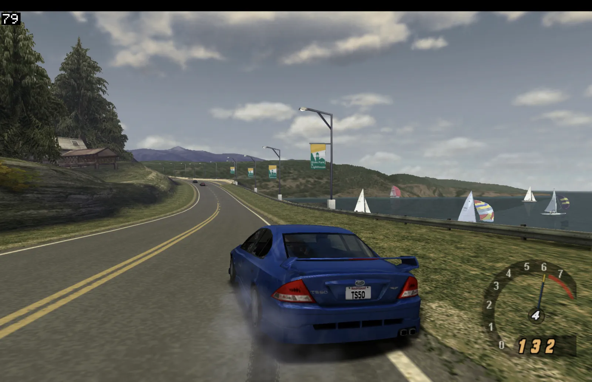
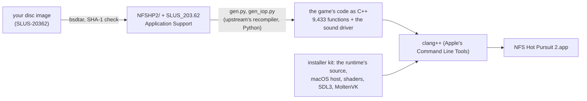
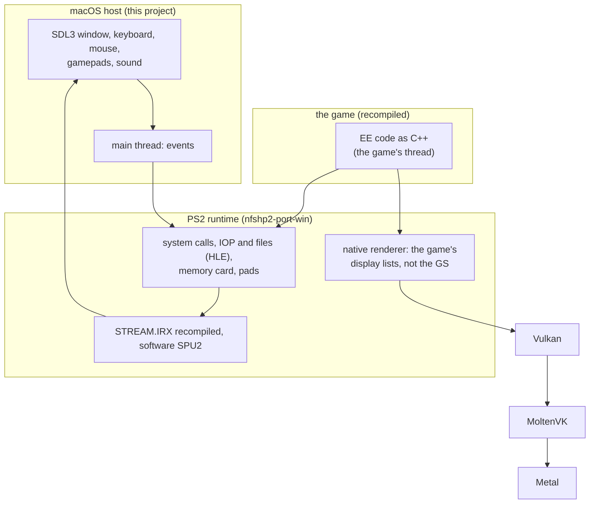

# NFS Hot Pursuit 2 for Mac

*Need for Speed: Hot Pursuit 2* (EA Black Box, 2002), the PlayStation 2 version, running natively on Apple Silicon Macs.

This is a macOS port of [nfshp2-port-win](https://github.com/ZloiKILLER/nfshp2-port-win) by **ZloiKILLER**, the static
recompilation of the PS2 game for Windows. Their project translates the game's MIPS code into C++ ahead of time and runs it on a
runtime that stands in for the PlayStation 2, with a renderer that draws the game's own display lists on Vulkan. Nearly everything
here is their work: the recompiler, the PS2 runtime, the renderer, the sound, the game's PC menus and settings. The way to run it
outside Windows comes from [nfshp2-web](https://github.com/vitorinii/nfshp2-web) by **Vitorini**. This project adds a macOS host
(window, input, sound, Vulkan on Metal) and an installer that builds the game on your Mac. All thanks go to them and to the projects
they build on (see [Credits](#credits)).

## Status

It runs at 60 fps on an M1 Pro (Options > PC Settings > frame rate 60) with a gamepad, and races, the menus, profiles and saves
work. But:

- It is **not actively supported**: an experiment, worked on when time allows.
- The game has **not been played from start to finish** on it.
- Apple Silicon and macOS 15 or newer only. Only the **USA release (SLUS-20362)** is supported (Europe v1.00 has the same program).
- Lighting may look a little darker than in PCSX2. It hasn't been compared frame by frame yet: the renderer is upstream's, not an
  emulation of the PS2's graphics chip.

How the port was made, step by step: [docs/PORTING.md](docs/PORTING.md). Changes per version: [CHANGELOG.md](CHANGELOG.md).

## Screenshots

| | |
|---|---|
|  |  |
|  |  |

## Install

You need an **Apple Silicon Mac with macOS 15 or newer** and your own disc image (ISO) of the **USA PlayStation 2 release** of
*Need for Speed: Hot Pursuit 2* (SLUS-20362). No game files are included, and no game code: the game is built on your Mac from
your disc.

1. Download `NFS-Hot-Pursuit-2-<version>.dmg` from [Releases](https://github.com/sanyokkua/nfs-hp2-ps2-port/releases/latest),
   open it and drag **NFS Hot Pursuit 2 Installer** to Applications.
2. **Open it.** The installer isn't notarized by Apple, so the first time macOS refuses. Close that message (don't move it to the
   Trash), go to **System Settings > Privacy & Security**, scroll to the message about it, click **Open Anyway** and confirm.
3. **Apple's Command Line Tools.** The game is compiled on your Mac with them. If they aren't installed, macOS offers to install
   them: click Install, and the installer goes on by itself when they are there.
4. **Choose your disc image.** The installer checks it (the program `SLUS_203.62` must be the USA release's), copies the game's
   files (2.9 GB) into `~/Library/Application Support/NFS Hot Pursuit 2`, translates the game's program to C++ and compiles it. On
   an M1 Pro that takes under a minute, once.
5. **NFS Hot Pursuit 2** is put in Applications (in `~/Applications` when Applications isn't writable) and opens. Play it from
   there; you can delete the disc image and the installer afterwards. Opening the installer again offers Play or Rebuild.

**Settings** are the game's own: **Options > PC Settings** (picture scale, 30 or 60 fps and more, aspect 4:3/16:10/16:9,
anti-aliasing, anisotropic filtering, draw distance, reflections, brightness/contrast/gamma, keys and gamepad). **Exit** is in the
main menu; **Cmd+Q** or closing the window also quits, and the profile is saved first. **Cmd+Enter** or **Cmd+F** switches full
screen. Gamepads: anything macOS knows (Xbox, PlayStation, MFi), with rumble.

**Your files:** `~/Library/Application Support/NFS Hot Pursuit 2/`: `hp2.ini` (settings), `saves/` (profiles), `logs/` (the
game's and the installer's logs), `game/` (the disc's files).

## How it works

The game's code isn't emulated: it is translated into C++ once, compiled for Apple Silicon, and runs on a runtime that does what
the PlayStation 2's hardware and system software did.

### Build time: from the disc to an app



### Run time: what happens while you play



- **CPU:** upstream's `gen.py` turns each MIPS R5900 function into a C++ function on a `Ctx` of registers and the PS2's 32 MB of
  memory. The EE's non-IEEE floats are modelled in software (`eefloat.h`, after PCSX2), so the game computes exactly what it
  does on a PS2: the game's recorded demo races replay with every world checksum matching (`tools/demo_check.sh`).
- **Graphics:** instead of emulating the Graphics Synthesizer and VU1, the renderer reads the game's own draw lists and draws them
  on Vulkan. On a Mac Vulkan is MoltenVK, on Metal.
- **Sound:** the IOP's sound driver (`STREAM.IRX`) is recompiled too and plays through a software SPU2, then SDL3.
- **macOS host:** SDL3 owns the main thread (AppKit wants it); the game runs on its own thread with a 64 MB stack. Keys, mouse and
  gamepads reach the runtime through nfshp2-web's input block.

## Build from source (macOS, Apple Silicon)

```sh
brew install cmake ninja glslang molten-vk
tools/fetch.sh                        # upstream/: nfshp2-port-win at the pinned commit + patches/
tools/install_disc.sh <your .iso>     # game-hp2/files: NFSHP2/ + data/SLUS_203.62
tools/gen.sh                          # the game's code as C++ (upstream/work/recomp/gen)
tools/build_deps.sh                   # SDL3 (macOS 15+), MoltenVK, Vulkan headers -> build/deps
cmake -S . -B build/mac -G Ninja -DHP2_DEMO_TESTS=ON
cmake --build build/mac               # hp2 (the game) and hp2_headless
ctest --test-dir build/mac            # the float test and the 5 demo replays (about 4 minutes)
HP2_DATA=$PWD/game-hp2/files build/mac/hp2
tools/make_app.sh                     # build/app/NFS Hot Pursuit 2.app (for your Mac only: it holds your disc's code)
tools/make_dmg.sh                     # the players' installer DMG (no game code; checked by tests/dmg_no_game_code.sh)
```

The repository holds no game files and no generated code. Releases are the installer: it carries the runtime's source and builds
the game on the player's Mac.

## Diagnostics

Upstream's environment variables work as they do on Windows, for example `HP2_DATA=<folder>` (the game's files),
`HP2_NATIVESHOT=<path%03d.bmp>` with `HP2_NATIVESHOTN=<frames>` (frame dumps), `HP2_NATIVELOG=1` (renderer log, long frames),
`HP2_DEMOREPLAY=<1..5>` with `HP2_DEMOQUIT=1` (play a demo recording and check it), `HP2_KEYSCRIPT=<file>` (scripted keys).
The installer: `HP2_IMPORT_ISO=<iso>`, `HP2_INSTALL_DIR=<folder>`, `HP2_NO_UI=1`. Logs are in
`~/Library/Application Support/NFS Hot Pursuit 2/logs/`.

## Credits

| Project | Author | What it gives this port | License |
|---|---|---|---|
| [nfshp2-port-win](https://github.com/ZloiKILLER/nfshp2-port-win) | ZloiKILLER | the recompiler, the PS2 runtime, the renderer, the sound, the PC menus: the port itself | no license file upstream; used and bundled here with credit, under this project's GPL-3.0-or-later |
| [nfshp2-web](https://github.com/vitorinii/nfshp2-web) | Vitorini | the POSIX host (input block, window and pad hosts), the software EE float, the demo-replay check | MIT |
| [PCSX2](https://github.com/PCSX2/pcsx2) | PCSX2 team | the EE float model upstream's `eefloat.h` follows | GPL-3.0-or-later |
| [NFSU2Deadware](https://github.com/LeoDeadware/NFSU2Deadware) | LeoDeadware | the "build it on the player's Mac" installer: CLT check, progress window, no-game-code test | MIT |
| [SpeedBreaker](https://github.com/SpeedBreakerProject) | project(u) | the idea and the style of these Mac ports, the dependency build | GPL-3.0 |
| [SDL3](https://github.com/libsdl-org/SDL) | SDL team | window, input, gamepads, sound | Zlib |
| [MoltenVK](https://github.com/KhronosGroup/MoltenVK) | Khronos | Vulkan on Metal | Apache-2.0 |
| [Vulkan-Headers](https://github.com/KhronosGroup/Vulkan-Headers), [glslang](https://github.com/KhronosGroup/glslang) | Khronos | Vulkan's headers, the shader compiler | Apache-2.0 / MIT, BSD-3-Clause |

The license texts: [LICENSES/](LICENSES/) and, in the installer, `Contents/Resources/kit/licenses/`. Details:
[THIRD_PARTY_NOTICES.md](THIRD_PARTY_NOTICES.md).

## License

GPL-3.0-or-later ([LICENSE](LICENSE), [NOTICE](NOTICE)). This project is built on, and its installer bundles the source of,
ZloiKILLER's [nfshp2-port-win](https://github.com/ZloiKILLER/nfshp2-port-win); its files keep their authorship and our changes to
them are in [patches/](patches/). **If you reuse this code, keep the credit to ZloiKILLER's project and its link**, as we do.
Files from nfshp2-web (`mac/web/`) stay under the MIT License.

## Legal notice

Unofficial fan project, not affiliated with or endorsed by Electronic Arts or Sony Interactive Entertainment. *Need for Speed* and
*Hot Pursuit* are trademarks of Electronic Arts Inc. This repository and its releases contain no game code and no game data: you
need your own legally obtained copy of the game, and the game is built from it on your own Mac.
